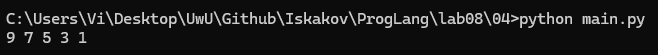
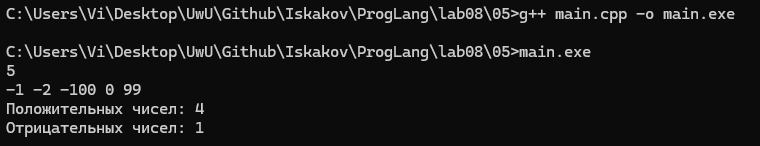
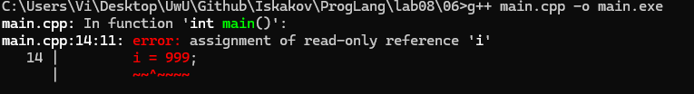
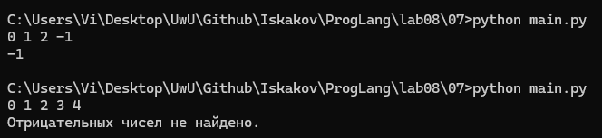
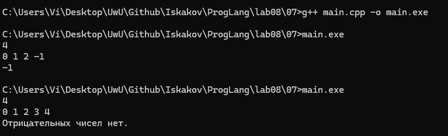
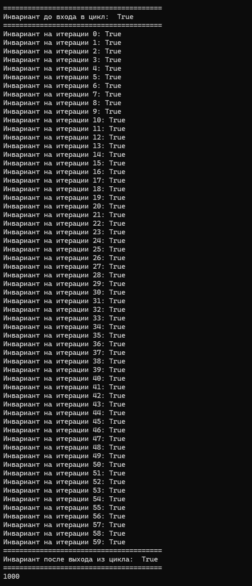

# Языки программирования
## Лабораторная работа 8

### Задание 1 **(2)**
*Рассмотрим программу на языке* **Python**.
```
x = [int(t) for t in input().split()]
for i in range(len(x)):
   if x[i] < i or x[i] > 2*i:
      break
print(i)
```
*Перепишите эту программу так, чтобы в ней использовался цикл* **while**, *в ней не использовалась
инструкция* **break**, *а используемый алгоритм не изменился. Полученная программа должна иметь следующий 
вид.*
```
x = [int(t) for t in input().split()]
i = 0
while ...:
   i += 1
print(i)
```
*Допишите правильное логическое выражение вместо многоточия. Выражение не должно содержать оператор* **not**.

**Создадим main.py**

```py
x = [int(t) for t in input().split()]
i = 0
while x[i] >= i and x[i] <= 2*i:
   i += 1
print(i)
```

**Объяснение:**

**Оригинальный код:**

Цикл `for` идет до тех пор, пока условие не выполнится. 

**Измененный код (main.py):**

По закону де Моргана сделаем из `x[i] < i or x[i] > 2*i` отрицание `x[i] >= i and x[i] <= 2*i`.

### Задание 2 **(2)**
*Рассмотрим программу на языке* **Python**.
```
x = [int(t) for t in input().split()]
for i in range(len(x)):
   if i <= x[i] < 2*i or 3*i <= x[i] < 4*i:
      break
print(i)
```

*Перепишите эту программу так, чтобы в ней использовался цикл* **while**, *в ней не использовалась
инструкция* **break**, *а используемый алгоритм не изменился. Полученная программа должна иметь следующий 
вид.*
```
x = [int(t) for t in input().split()]
i = 0
while ...:
   i += 1
print(i)
```
*Допишите правильное логическое выражение вместо многоточия. Выражение не должно содержать оператор* **not**.

**Создадим main.py**

```py
x = [int(t) for t in input().split()]
i = 0
while i < len(x) and (x[i] < i or x[i] >= 2 * i) and (x[i] < 3 * i or x[i] >= 4 * i):
   i += 1
print(i)
```

**Объяснение:**

**Оригинальный код:**

Цикл `for` идет до тех пор, пока условие не выполнится. 

**Измененный код (main.py):**

Раскроем первую часть условия `i <= x[i] < 2*i` в `x[i] >= i and 2 * i > x[i]`.
Раскроем вторую часть условия `3*i <= x[i] < 4*i` в `x[i] >= 3 * i and 4 * i > x[i]`

По закону де Моргана сделаем отрицание. При этом цикл может выйти за пределы последовательности, если условие всегда выполняется, поэтому добавляем дополнительное условие `i < len(x)` для выхода по окончании последовательности.

### Задание 3 **(2)**

*Напишите пример программы на* **Java** *с двумя вложенными циклами и инструкцией* **break** *для выхода
из двух вложенных циклов. В качестве такой программы можно взять поиск первого нуля в двумерном массиве.*

**Создадим файл Main.java**

```java
import java.util.List;
import java.util.ArrayList;
import java.util.Scanner;

public class Main {
    private static Boolean findFirstZeroInArray(int[][] matrix) {
        Boolean found = false;
        
        outerLoop:
        for (int[] row : matrix) {
            for (int j : row) {
                if (j == 0) {
                    found = true;
                    break outerLoop;
                }
            }
        }

        return found;
    }

    public static void main(String[] args) {
        int[][] testMatrix = {{1, 2, 3}, {-1, -2, -3}, {0, 99, 55}};

        System.out.println(findFirstZeroInArray(testMatrix));
    }
}
```

**Объяснение**

Посмотрим документацию:

https://docs.oracle.com/javase/specs/jls/se23/html/jls-14.html#jls-14.15

Согласно документации, параграф *$14.15$. The Break Statement*, существует два вида `break`:
1. `break` без метки
2. `break` с меткой

Используем `break` с меткой `outerLoop:`, что позволяет `break` попытатья передать управление помеченному блоку и выйти из вложенного цикла. Заметим, что метка должны быть видна из места, откуда вызывается `break`. При попытке обратиться к несуществующей метке, будет ошибка компиляции. 

### Задание 4 **(2)**

*Рассмотрим программу на языке* **Python**.
```
a = list(range(10))
b = [a.pop() - x for x in a]
print(*b)
```
*Объясните, почему список* **b** *получился именно таким.*

**Создадим файл main.py**
```py
a = list(range(10))
b = [a.pop() - x for x in a]
print(*b)
```

**Запустим и проверим результат**



**Объяснение**

`a.pop()` имеет побочное действие, то есть меняет среду исполнения, меняет список `a`. Разберём по порядку:

1. Итерация 1
- x = 0, len(a) = 10 
- a.pop() - x -> 9 - 0 = 9
- a = [0, 1, 2, 3, 4, 5, 6, 7, 8]
- b = [9]
2. Итерация 2
- x = 1, len(a) = 9
- a.pop() - x -> 8 - 1 = 7
- a = [0, 1, 2, 3, 4, 5, 6, 7]
- b = [9, 7]  
3. Итерация 3
- x = 2, len(a) = 8
- a.pop() - x -> 7 - 2 = 5
- a = [0, 1, 2, 3, 4, 5, 6]
- b = [9, 7, 5]  
4. Итерация 4
- x = 3, len(a) = 7
- a.pop() - x -> 6 - 3 = 3
- a = [0, 1, 2, 3, 4, 5]
- b = [9, 7, 5, 3]  
5. Итерация 5
- x = 4, len(a) = 6
- a.pop() - x -> 5 - 4 = 1
- a = [0, 1, 2, 3, 4]
- b = [9, 7, 5, 3, 1]
6. Итерация 6
- x = 5, len(a) = 5
Стоп. Итератор не может взять a[5]

Таким образом, это подтверждает сказанное в Лекции 8, слайд 228: *При конструировании списка в функциональной парадигме использован метод с побочным действием, которого в рамках функционального программирования быть вообще не должно.*. 

### Задание 5 **(2)**

*Напишите программу на С++, которая прочитает натуральное число* **n**, *создаст вектор
из* **n** *элементов, прочитает значения элементов, добавит последний элемент вектора к каждому элементу 
(в том числе и к последнему), найдет и выведет количество положительных и отрицательных элементов вектора
после изменения. Из циклов в программе можно использовать только циклы по коллекции.*

**Создадим файл main.cpp**

```cpp
#include <iostream>
#include <vector>

int main() {
    int n;
    std::cin >> n;

    std::vector<int> v(n);

    for (int& i : v) {
        std::cin >> i;
    }

    int positive_nums_count = 0;
    int negative_nums_count = 0;
    int last = v.back();

    for (int& i : v) {
        i += last;  
        if (i < 0) negative_nums_count++;
        if (i > 0) positive_nums_count++;
    }

    std::cout << "Положительных чисел: " << positive_nums_count << "\n" << "Отрицательных чисел: " << negative_nums_count << "\n";

    return 0;
}
```

**Компилируем, запускаем, вводим тестовый набор данных и смотрим результат**



**Объяснение**

Полные комментарии к коду будут скорее излишними, но отметим, что был взят пример из Лекции 8, слайд 237 для цикла по коллекции:
Цикл по коллекции в С++ имеет следующий вид.
- `for ( type x : collection )`
Если требуется изменять содержимое коллекции, то можно использовать ссылки.
- `for ( type &x : collection )` 

### Задание 6 **(3)**

*Представим, что в некотором будущем стандарте* **С++** *появится конструкция*
```
forc(i, from, to)
```
*которая будет раскрываться в следующий код.*
```
{
   int __i = from, __n=to;
   for(const int &i= __i; i < __n; __i++) {
      ...
   }
}
```
*Чем эта конструкция отличается от стандартного цикла* **for**? *Укажите два основных различия.
Напишите программы для демонстрации этих различий.*

*Написанные программы сохраните в папку с номером задания.*

**Создадим файл main.cpp**

```cpp
#define forc(i, from, to) \
{ \
   int __i = from, __n = to; \
   for(const int &i = __i; i < __n; __i++) {

#define end_forc \
   } \
}

int main() {    
    forc(i, 0, 100) {
        i = 999;
    }
    end_forc;

    return 0;
}
```

**Компилируем и видим ошибку**



Первое отличие в том, что `i` не может быть изменена, так как `const int &i` делает ее константой ссылкой. Меняется только `__i`. Так мы не нарушаем правило структурного программирования. 
Второе отличие в том, что нижняя и верхняя границы цикла удаляются после выполнения цикла, так как живут в блоке `{}`. Так удаляются `__i`, `__n`. 

### Задание 7 **(2)**

*Напишите программу на языке* **Python** *для проверки того, что все числа во введенной 
последовательности неотрицательные. Если в цикле будет найдено отрицательное число, цикл должен
прерваться и вывести найденное число. Если отрицательных чисел нет, то вывести некоторое сообщение об этом.*

*Программа должна использовать конструкцию* **for break else**.

*Запишите аналогичную программу на С++. Какие изменения в алгоритме решения в ней появились?. Почему?*

*Написанные программы сохраните в папку с номером задания.*

**Создадим файл main.py**

```py
seq = map(int, input().split())

for i in seq:
    if i < 0:
        print(i)
        break
else:
    print("Отрицательных чисел не найдено.")
```

**Запустим и проверим на двух наборах тестовых данных**



**Создадим файл main.cpp**

```cpp
#include <iostream>

int main() {
    int n;
    std::cin >> n;

    bool found = false;

    for (int i = 0; i < n; i++) {
        int x;
        std::cin >> x;

        if (x < 0) {
            found = true;
            std::cout << x << std::endl;
            break;
        }
    }

    if (!found) {
        std::cout << "Отрицательных чисел нет." << std::endl;
    }

    return 0;
}
```

**Запустим и проверим на двух наборах тестовых данных**



Согласно Лекции 8, слайд 241: 

*В Python существует возможность дописать фрагмент кода в том случае, если выход из цикла произошел по предусловию или в связи с концом последовательности. Для этого используется ключевое слово else.*

То есть `else` сработает тогда, когда цикл завершился или условие с выходом из цикла не выполнилось. 

В С++ такой возможности нет, поэтому приходится заводить переменную `found`, чтобы отслеживать по какой причине завершился цикл. Мы запоминаем причину завершения цикла и по ней решаем, выполнять ли блок кода после цикла.  

### Задание 8 **(2)**

*Рассмотрим следующую программу.* 
```
if x>=5 and y>=-5:
   print(0):
elif x<0 or y<0:
   print(1):
else:
   print(2):
```
*Опишите множества значений при которых программа выводит 0, 1 и 2. Например,*

**Для 0:**

`A = {(x, y) | x ∈ [5;∞), y ∈ [-5;∞)}`

**Для 1:**

`B = {(x, y) | x ∈ (-∞, 0), y ∈ (-∞, +∞)}`
`C = {(x, y) | x ∈ (-∞, 5), y ∈ (-∞, 0)}`
`D = B ∪ C`

**Для 2::**

`E = {(x, y) | x ∈ [0, 5), y ∈ [0, +∞)}`

###  Задание 9 **(3)**
*Напишите программу на языке Python для решения следующей задачи.*

*Задана пронумерованная последовательность логических значений* **t(0),t(1),..,t(n)**, **t(i) ∈ {False,True}**

*Последовательность обладает следующим свойством: существует некоторое число k такое, что 
все значения* **t(0),t(1),...,t(k-1)** *равны* **False**, *а все значения* **t(k), ... , t(n)** *равны* **True**,
*то есть слева от* **k** *находятся значения* **False**, *а справа* - **True**. *Последовательность задается
функцией* **t(i)**, *которая возвращает логическое значение. Например, для тестирования эту функцию можно
задать следующим образом.*
```
def t(i):
   return i>=1000
```

*Требуется написать программу, которая найдет число* **k**. *Программа должна реализовывать алгоритм 
бинарного поиска. Диапазон поиска задается переменными* **left** и **right**. *На каждом шаге вычисляется
центр диапазона, значение в нем проверяется, после чего диапазон сокращается в два раза.*

*Алгоритм должен быть записан через цикл* **while** *и реализовывать инвариант цикла*

t(left)=False ∧ t(right)=True

```
left = -1
right = 10**18
while ...:
   mid = ...
   if t(mid):
      ...
   else:
      ...
print(...)
```

**Создадим файл main.py**

```py
def t(i):
   return i>=1000

left = -1
right = 10**18
while right - left > 1:
   mid = left + (right - left) // 2
   if t(mid):
      right = mid
   else:
      left = mid
print(right)
```

*Инвариант в программировании — это некоторый логический предикат (логическое выражение), связанный с определенной точкой или множеством точек в программе.*

Согласно условию задачи, всегда найдется k такое, что **t(0),t(1),...,t(k-1)** *равны* **False**, *а все значения* **t(k), ... , t(n)** *равны* **True**, то есть нам нужно найти точку перехода от False к True. 
Инвариант `t(left)=False ∧ t(right)=True` должен быть истинным до входа в цикл, на каждой итерации и после выходе из цикла. Чтобы не менять оригинальный код, добавим вывод инварианта на каждой контрольной точке.

**Создадим test.py**

```py
def t(i):
   return i>=1000

left = -1
right = 10**18

print("=======================================")
print("Инвариант до входа в цикл: ", not t(left) and t(right))
print("=======================================")

i = 0

while right - left > 1:
   mid = left + (right - left) // 2
   if t(mid):
      right = mid
   else:
      left = mid
   print(f"Инвариант на итерации {i}: {not t(left) and t(right)}")
   i += 1

print("=======================================")
print("Инвариант после выхода из цикла: ", not t(left) and t(right))
print("=======================================")

print(right)
```

**Запустим и проверим**



Видим, что инвариант является истинным на каждой точке. Таким образом, программа работает корректно.

## Дополнительные задания

### Задание 1 **(5)**

*Напишите программу на языке С++, которая будет находить сумму элементов в матрице и использовать для суммирования только один цикл* **for**. *(То есть вложенные циклы использовать нельзя).*

### Задание 2 **(15)**
*Напишите программы на языке С++ с использованием разных видов циклов, ветвлений в полной и краткой форме, переведите их в ассемблерный код без оптимизации и опишите, как реализуются эти конструкции в элементарных командах.
правил.*
