# Языки программирования
## Лабораторная работа 9

### Задание 1 **(2)**
*Рассмотрим следующую программу.*
```
d = {'sep': ',' , 'end': '\n'}
l = ['Утопия', 14, 'Вселенная', 25]
print (l, d)
print (*l, d)
print (*l, *d)
print (*l, **d)
```
*Объясните результаты ее работы.*

*При устном ответе на вопросы вам потребуется рассказать, что такое "Утопия 14" и "Вселенная 25".*

**Создадим файл main.py**
```py
d = {'sep': ',' , 'end': '\n'}
l = ['Утопия', 14, 'Вселенная', 25]
print (l, d)
print (*l, d)
print (*l, *d)
print (*l, **d)
```

**Запустим и проверим результат**

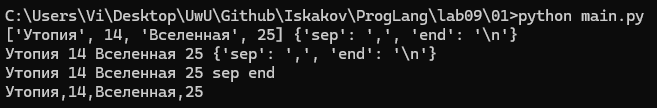

*Знаменитый эксперимент «Вселенная-25» (англ. Universe 25) – самая известная работа американского ученого-этолога Джона  Кэлхуна. Он проводил исследования на животных с целью прогнозирования развития человечества: моделировал различные условия для грызунов и наблюдал за подопытными, составлял выводы и проводил аналогии с обществом людей.*

*«Механическое пианино» (англ. Player Piano) или «Утопия 14» — первый роман Курта Воннегута. Опубликован в 1952 году. Действие романа-антиутопии происходит в недалёком будущем, в котором ручной труд почти повсеместно заменён машинным. Широко распространённая механизация вызывает социальные противоречия между зажиточным верхним классом — инженерами и менеджерами, — и нижним, чьи навыки были заменены машинным трудом. Книга представляет собой пример «мягкой фантастики», где основной упор делается не на технические особенности, а на социальные аспекты возможного будущего. В романе присутствуют элементы иронии и сентиментальности, которые впоследствии станут отличительной чертой прозы Воннегута.*

**1. print(l, d)**

Просто выводит список и словарь как есть.

**2. print(*l, d)**

Распаковывает список `l` и выводит каждый элемент. Словарь `d` выводится как есть. 

**3. print(*l, *d)**

Распаковывает список `l` и выводит каждый элемент. Распаковывает словарь `d` и выводит каждый ключ.

**4. print(*l, **d)**

`**d` применил разделитель из словаря и символ для конца строки к выводу распакованного списка `l`, то есть он их дал `print` в виде аргументов.

### Задание 2 **(2)**
*Напишите функцию* **sublist** для решения следующей задачи.*

*На вход функции поступает список или кортеж и набор номеров позиций.
Функция должна составить и вернуть список из элементов, которые
находятся на этих позициях. Примеры работы приводятся ниже. Работа функции должна строго им соответствовать.*

```
>>> lst = [ 'Anna', 'Barbara', 'Clara', 'Diana', 'Eva', 'Flora']
>>> sublist(lst, 0, 2, 5)
['Anna', 'Clara', 'Flora']
>>> sublist (lst)
[]
>>> sublist(lst, 0, 1, 2, 3, 4, 5)
['Anna', 'Barbara', 'Clara', 'Diana', 'Eva', 'Flora']
```

**Создадим файл main.py**

```py
def sublist(a, *args):
    return [a[i] for i in args]

lst = ['Anna', 'Barbara', 'Clara', 'Diana', 'Eva', 'Flora']
# Expected: ['Anna', 'Clara', 'Flora']
print(sublist(lst, 0, 2, 5))

# Expected: []
print(sublist(lst))

# Expected: ['Anna', 'Barbara', 'Clara', 'Diana', 'Eva', 'Flora']
print(sublist(lst, 0, 1, 2, 3, 4, 5))
```

Запустим и проверим результат

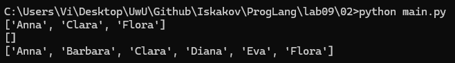

**Объяснение**

*Доступ к кортежу из оставшихся параметров можно получить через специальный параметр *args. Имя после звездочки может быть произвольным*

Функция `sublist` принимает список и произвольное количество аргументов для позиций нужных элементов, которые мы получаем через `*args`.
Итератором мы можем получить каждую позицию из списка `*args` для заполнение нового списка из указанных элементов.

*Примечание: это самый простой пример программы без обработки отрицательных или выходящих за пределы индексов.*

### Задание 3 **(1)**

*Задан список* **lst** *из натуральных чисел*. *Напишите фрагмент
программы, состоящий из одного вызова функции* **max**, *который найдет в этом списке число с максимальным
числом единиц в двоичной записи.* 

*Многоточие надо заменить на лямбда-функцию, использующую фукцию* **bin** *и метод строк* **count**.

*Пример работы приводится ниже.*
```
>>> lst = list(range(6000 ,7000))
>>> ans = max(lst,...)
>>> print(ans)
6143
```

**Создадим файл main.py**

```py
lst = list(range(6000 ,7000))
ans = max(lst, key=lambda x: bin(x).count('1'))
print(ans)
```

**Запустим и проверим результат**

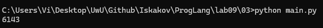

**Объяснение**

Использовали лямбда функцию - анонимную функцию, которая обычно используется для определения некоторой операции вкоде другой функции.

`key` нужен был для того чтобы функция `max` не воспринимала нашу лямбда функцию как второй аргумент для сравнения. Он задает параметр, по которому мы будем искать максимальный элемент в списке по количеству единиц в двоичной записи, то есть у кого больше единиц, тот и макс.

### Задание 4 **(2)**

*Запишите фрагмент программы, которая упорядочит список слов
по длине, а при равенстве длины - лексикографически. Сортировка
должна состоять из одного вызова метода* **sort**.

*Пример работы приводится ниже.*

```
>>> lst = ['hello', 'hell', 'bye', 'world', 'bybye']
>>> lst.sort (...)
>>> print (lst)
['bye', 'hell', 'babye', 'hello', 'world']
```

**Создадим файл main.py**

```py
lst = ['hello', 'hell', 'bye', 'world', 'bybye']

lst.sort(key=lambda s: (len(s), s))

# Expected: ['bye', 'hell', 'babye', 'hello', 'world']
print(lst)
```

**Запустим и проверим результат**

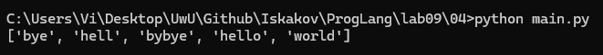

**Объяснение**

Использовали похожую конструкцию с лямбда функицями из *Задания 3*, но добавили новое правило сортировки после запятой `(len(s), s)`: если длина слов одинакова, то они сортируются лексикографически.

### Задание 5 **(2)**

*Напишите программу для решения следующей задачи.*

*В одной строке через запятую записана последовательность слов. Перед
запятой или после нее могут быть пробелы, сами слова пробелов не
содержат. Программа должна вывести в одной строке через запятую
последовательность чисел, равных длине каждого слова. Например,
для ввода*
```
hello   ,   world ,   and ,   goodbye
```
*программа должна вывести*
```
5, 5, 3, 7
```
*Программа должна быть написана с использованием парадигмы функционального программирования, то есть без использования циклов, присваиваний и т.д. Программа может использовать функции* **input**, **print**, **len**, **map** *и методы строк* **split** и **strip**.

**Создадим файл main.py**

```py
print(*map(len, map(str.strip, input().split(','))), sep=', ')
```

**Запустим и проверим результат**

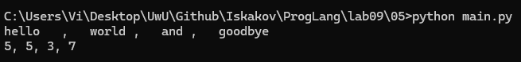

**Объяснение**

Напомним, что в парадигме функционального программирования каждая переменная обозначает один и тот же объект на протяжении всей ее области действия. Используем декларативный подход и сконструируем программу, хотя по мере того, как мы пишем код, мы будем видеть что программа читается как бы от конца к началу, то есть начинаем с `print` (последнее действие), а заканчиваем с `map(str.strip, input().split(','))` (первое действие). 

### Задание 6 **(2)**

*Запишите генератор в форме функции, который будет создаватьпоследовательность по следующему правилу.*

* *Если текущее число x в последовательности четное, то следующее число равно x/2.*
* *Иначе следующее число равно 3x + 1.* 

*Последовательность начинается с заданного числа n и заканчивается единицей.*

*Далее приведен пример работы генератора.*
```
>>> print (*gen(7))
7 22 11 34 17 52 26 13 40 20 10 5 16 8 4 2 1
```

**Создадим файл main.py**

```py
def gen(x):
    yield x
    while x > 1:
        if x % 2 == 0:
            x //= 2
        else:
            x = 3 * x + 1
        yield x
print(*gen(7))
```

**Запустим и проверим результат**

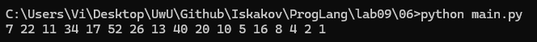

**Объяснение**

Генератор начинает работу и останавливается на первом `yield x`, продолжает работу, доходит до второго `yield x`, и уже при следующем вызове она продолжает работу с точки, на которой остановилась (генератор - это тоже итератор).

### Задание 7 **(2)**

*Напишите генератор, который для заданной последовательности*
**seq** *будет задавать последовательность из каждого второго элемента* **seq**.

```
def every_other ( seq )
    ...
```
*Ниже приведены примеры использования генератра.*
```
>>> print (*every_other([10, 20, 30, 40, 50]))
10 30 50
>>> print(*every_other(range(10)))
0 2 4 6 8
>>> print(*every_other(iter(range(10))))
0 2 4 6 8
>>> print(sum(every_other(map(int, input().split()))))
2 5 11 3 8
21
```

**Создадим файл main.py**

```py
def every_other(seq):
    it = iter(seq)
    x = next(it, None)
    while x != None:
        yield x
        x = next(it, None)
        x = next(it, None)
    
print(*every_other([1,2,3,4,5]))

# Expected: 10 30 50
print (*every_other([10, 20, 30, 40, 50]))

# Expected: 0 2 4 6 8
print(*every_other(range(10)))

# Expected: 0 2 4 6 8
print(*every_other(iter(range(10))))

# Expected: 2 5 11 3 8
print(sum(every_other(map(int, input().split()))))
```

**Запустим и проверим результат**

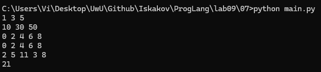

**Объяснение**

Здесь как раз таки и пригодился метод итератора `next()` в нашем генераторе `every_other()` для того, чтобы пройтись по последовательности и вывести элемента списка через раз. Однако отметим, что мы использовали не самую правильную и разумную защиту от выхода за пределы списка, и вместо `None` стоило бы добавить обработку ошибок. 

### Задание 8 **(2)**

*Задан список* **lst**, *в котором записаны вперемешку числа и строки.*. 
*Напишите фрагмент программы, состоящий из одного конструктора списков, который построит новый список, состоящий только из чисел.* 

*Определить тип объекта в Python можно с использованием функции* **type**.

*Пример работы приводится ниже.*

```
>>> lst = [1,'abc', 2, 3, 4, 'aa']
>>> nums = [...]
>>> print(nums)
[1, 2, 3, 4]
```

**Создадим файл main.py**

```py
lst = [1,'abc', 2, 3, 4, 'aa']
nums = [el for el in lst if type(el) == int]

# Expected: [1, 2, 3, 4]
print(nums)
```

**Запустим и проверим результат**

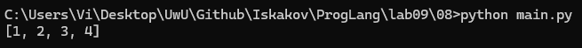

**Объяснение**

Использовали генератор внутри списка для создания нового списка по условию: оставляем только числа. Можно псевдокодом было бы объяснить это так: [ВЫРАЖЕНИЕ for el in lst if УСЛОВИЕ].

###  Задание 9 **(2)**

*Напишите фрагмент программы, состоящий из одного конструктора списков, который построит двумерный список в виде таблицы умножения размера* 
**n×n**.

*Пример работы приводится ниже.*

```
>>> n = 5
>>> tblmul = [...]
>>> print(*tblmul,sep='\n')
[1, 2, 3, 4, 5]
[2, 4, 6, 8, 10]
[3, 6, 9, 12, 15]
[4, 8, 12, 16, 20]
[5, 10, 15, 20, 25]
```

**Создадим файл main.py**

```py
n = 5
tblmul = [[(col + 1) * (row + 1) for col in range(n)] for row in range(n)]
print(*tblmul,sep='\n')

# Expected: 
# [1, 2, 3, 4, 5]
# [2, 4, 6, 8, 10]
# [3, 6, 9, 12, 15]
# [4, 8, 12, 16, 20]
# [5, 10, 15, 20, 25]
```

**Запустим и проверим результат**

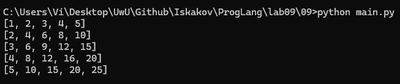

**Объяснение**

По сути мы записали вложенный цикл в конструкторе списков, что можно было бы описать так: [[ВЫРАЖЕНИЕ for СТОЛБЕЦ in range(n)] for СТРОКА in range(n)]

###  Задание 10 **(1)**
*Какие из указанных функций и методов Python соответствуют определению чистых функций?
В случае отрицательного ответа требуется дать пояснение.*

* **file.readline|** — *чтение строки из файла.*
* **len** — *определение длины строки или количества элементов в контейнере.*
* **list.append** — *добавление в список нового элемента.*
* **sum** — *нахождение суммы.*
* **sorted** — *построение сортированного списка.*
* **list.sort** — *сортировка списка.*
* **random.randint** — *генерация случайного целого числа.*
* *Разворот списка.*
```
def rev(x):
    return x[::-1]
```
* *Выбор нескольких элементов из хвоста списка.*
```
tail_len = 3
def tail(x):
    return x[-tail_len:]
```

1. `file.readline|`. Не является чистой. Ввод - побочное действие.
2. `len`. Чистая.
3. `list.append`. Не является чистой. Изменяет исходный список через append - побочное действие.
4. `sum`. Чистая.
5. `sorted`. Чистая.
6. `list.sort`. Не является чистой. Изменяет исходный список - побочное действие. 
7. `random.randint`. Не является чистой. Одинаковый аргумент дает разные значения. 
8. Разворот списка.

```py
def rev(x):
    return x[::-1]
```
Чистая.
9. Выбор нескольких элементов из хвоста списка.

```py
tail_len = 3
def tail(x):
    return x[-tail_len:]
```
Не является чистой. Зависит от глобальной переменной `tail_len`, а не только от своих параметров.

###  Задание 11 **(2)**
*Рассмотрите следующую функцию.*
```
def toint(fun):
    def wrapper(*args):
        return fun(*map(int, args))
    return wrapper
```
*Что передается в функцию* **toint**? *Что возвращает эта функция?*
*Что делает функция* **wrapper**?
*Придумайте несколько примеров использования* **toint**.

В функицю `toint` передается другая функция `fun`. 

Функция `toint` возвращает функцию-обертку `wrapper` (НЕ вызов функции!).

Функция `wrapper` берет список аргументов функции `fun`, вызывает функцию `fun` с уже преобразованными аргументами в тип `int`.

Примеры использования:

1. Чтобы сложить два числа, когда мы передали их в виде строк.

```py
def toint(fun):
    def wrapper(*args):
        return fun(*map(int, args))
    return wrapper

def add(a, b):
    return a + b

add_int = toint(add)
print(add_int("2", "3"))    
```

**Запустим и проверим результат**

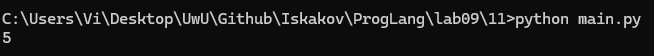

2. Чтобы не писать каждый раз int(x) когда вводим числа. 

```py
def toint(fun):
    def wrapper(*args):
        return fun(*map(int, args))
    return wrapper
    
def add(a, b):
    return a + b

add_int = toint(add)

print(add_int(*input().split()))
```

**Запустим и проверим результат**

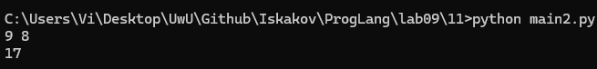

## Дополнительные задания

### Задание 1 **(3)**

*Самостоятельно познакомьтесь с понятием декораторов в Python. Приведите примеры использования
функции* **toint** *из задания выше в качестве декоратора.*


### Задание 2 **(3)**
*Напишите фрагмент программы, которая найдет в списке слов слово с максимальной длиной. При равенстве длин
найдет самое первое в лексикографическом порядке.*

*Фрагмент программы должен состоять из одного вызова функции* **min** *или* **max**.

### Задание 3 **(5)**

*Напишите рекурсивную функцию для нахождения* **n**-о *числа Фибоначчи.*

*Функция обязательно должна работать с достаточно большими числами, например* **n = 1000** *и не 
должна использовать библиотечные функции и методы.*

### Задание 4 **(9)**

*Напишите функцию* **fastpow**, *которая будет создавать лямбда-функцию для быстрого 
возведения в фиксированную степень* **n**. *Например, должен работать следующий код*
```
>>> pow10 = fastpow(10)
>>> print(pow10(2))
1024
```
*Функция* **fastpow** *в этом примере должна строить выражение для быстрого возведения в степень
по стандартному алгоритму* 
* **x^1 = x**;
* **x^{2n} = (x^n) ** 2**; 
* **x^{2n+1}=x*x^{2n}**;

*Например,
для* **n = 10** *может быть получена подобная строка* ```(x*((x**2)**2))**2```. 

*Далее* **fastpow** *будет возвращать лямбда функцию*
```
lambda x: eval(s)
```
*При написании функции* **fastpow** *можно использовать вспомогательные функции.*


