# Языки программирования 
## Лабораторная работа 10

### Задание 1 **(2)**

*Рассмотрите следующие фрагменты программ. Запишите, что означают символы* **&** и  * *в каждом случае применения.*
```
int a = 10, b = 20;
int *p = &a , *q = &b;
p = q;
std::cout << *p <<' '<< *q << std::endl;
```
```
int a = 10, b = 20;
int *p = &a , *q = &b;
*p = *q;
std::cout << *p <<' '<< *q << std::endl;
```
*Чем различаются присваивания в третьей строке? Что можно вывести,
чтобы показать различия?*

*Примеры программ сохраните в папке с номером задания. Скриншоты работы прикрепите к отчету.*

**Создадим файл main.cpp**

```cpp
#include <iostream>

int main() {
    int a = 10, b = 20;
    int *p = &a, *q = &b;
    
    p = q;
    std::cout << "p = q:" << std::endl;
    std::cout << "a=" << a << " b=" << b << std::endl;
    std::cout << "p=" << p << " q=" << q << std::endl;
    std::cout << "*p=" << *p << " *q=" << *q << std::endl;
    
    return 0;
}
```

**Компилируем, запустим, проверим результат**

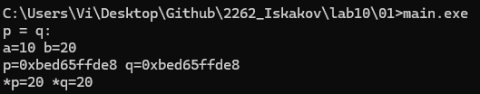

**Создадим файл main2.cpp**

```cpp
#include <iostream>

int main() {
    int a = 10, b = 20;
    int *p = &a, *q = &b;
    
    *p = *q;
    std::cout << "*p = *q:" << std::endl;
    std::cout << "a=" << a << " b=" << b << std::endl;
    std::cout << "p=" << p << " q=" << q << std::endl;
    std::cout << "*p=" << *p << " *q=" << *q << std::endl;
    
    return 0;
}
```

**Компилируем, запустим, проверим результат**

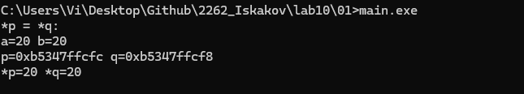

**Объяснение**

В первой программе `*` при объявлении `int *p` - это указатель, `&a` - адрес переменной `a`. В `p = q` копируется адрес, а `p` теперь указывает туда же, куда и `q` (на b). Выводится 20 20.
Во второй программе `*p` = `*q` - разыменование с обеих сторон. Значение из `b` записывается в `a`. Указатели не меняются, `p` всё ещё указывает на `a`, `q` - на `b`. Выводится 20 20, но `a` стало равно 20.
Чтобы показать разницу, можно вывести `a`, `b`, `p`, `q`:

- в первом случае a=10, b=20, адреса p и q совпадают
- во втором случае a=20, b=20, адреса p и q разные

### Задание 2 **(1)**

*Рассмотрим следующую программу.* 
```
double x[10];
for (int i = 0; i <10; i++)
    std::cout << &x[i] << std::endl;
```
*Что она выводит? Измените вывод так, чтобы адреса выводились в десятичной системе счисления. Объясните почему числа составляют арифметическую прогрессию с определенным шагом.*

*Записанную программу сохраните в папке с номером задания.*
*Скриншоты работы прикрепите к отчету.*

**Создадим файл main.cpp**

```cpp
#include <iostream>

int main() {
    double x[10];
    for (int i = 0; i < 10; i++)
        std::cout << reinterpret_cast<size_t>(&x[i]) << std::endl;
    return 0;
}
```

**Компилируем, запустим, проверим результат**

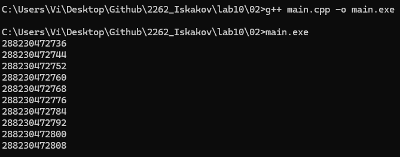

**Объяснение**

Программа выводит адреса элементов массива. По умолчанию в C++ они печатаются в шестнадцатеричном виде. Чтобы получить обычные десятичные числа, мы приводим адрес к целочисленному типу `size_t` с помощью `reinterpret_cast`. Числа идут с постоянным шагом (образуют арифметическую прогрессию), потому что элементы массива лежат в памяти строго подряд. Шаг этой прогрессии равен размеру одного элемента типа double, то есть 8 байтам.

### Задание 3 **(2)**

*Токен* **«*»** *в языке C++ может использоваться в трех различных случаях. Аналогично токен* **«&»** *также может использоваться в трех случаях. Приведите пример одной программы в которой они были бы использованы во всех случаях.*

*Записанную программу сохраните в папке с номером задания.*

**Создадим файл main.cpp**

```cpp
#include <iostream>

int main() {
    int a = 5, b = 3;
    
    int c = a * b;
    
    int *p = &a;
    
    *p = 10;
    
    int d = a & b;
    
    int &ref = a;
    ref = 20;
    
    std::cout << "c = " << c << std::endl;
    std::cout << "*p = " << *p << std::endl;
    std::cout << "d = " << d << std::endl;
    std::cout << "ref = " << ref << std::endl;
    
    return 0;
}
```

**Компилируем, запустим, проверим результат**

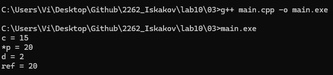

**Объяснение**

В этой программе токен * встречается в трёх ролях:

- a * b — обычное умножение чисел
- int *p — объявление указателя на int
- *p = 10 — разыменование, записываем значение по адресу

И токен & тоже в трёх ролях:

- &a — взятие адреса переменной a
- a & b — побитовое И (5 это 101, 3 это 011, результат 001 = 1)
- int &ref — объявление ссылки на a

### Задание 4 **(2)**

*Выпишите значения всех переменных, в том числе указателей, после выполнения каждой инструкции программы. Объясните, что происходит в результате выполнения каждой инструкции.*
```
unsigned a = 8, b = 3 ,c = 17;
unsigned *p = &a;
unsigned *q = &b;
*p += *q + c;
c = *q;
p = &c;
c += a;
*p += 10;
*q = *p;
q = p ;
*q += 10;
```

**Создадим файл main.cpp**

```cpp
#include <iostream>

int main() {
    unsigned a = 8, b = 3, c = 17;
    unsigned *p = &a;
    unsigned *q = &b;
    std::cout << "a=" << a << " b=" << b << " c=" << c << " *p=" << *p << " *q=" << *q << std::endl;

    *p += *q + c;
    std::cout << "a=" << a << " b=" << b << " c=" << c << " *p=" << *p << " *q=" << *q << std::endl;

    c = *q;
    std::cout << "a=" << a << " b=" << b << " c=" << c << " *p=" << *p << " *q=" << *q << std::endl;

    p = &c;
    std::cout << "a=" << a << " b=" << b << " c=" << c << " *p=" << *p << " *q=" << *q << std::endl;

    c += a;
    std::cout << "a=" << a << " b=" << b << " c=" << c << " *p=" << *p << " *q=" << *q << std::endl;

    *p += 10;
    std::cout << "a=" << a << " b=" << b << " c=" << c << " *p=" << *p << " *q=" << *q << std::endl;

    *q = *p;
    std::cout << "a=" << a << " b=" << b << " c=" << c << " *p=" << *p << " *q=" << *q << std::endl;

    q = p;
    std::cout << "a=" << a << " b=" << b << " c=" << c << " *p=" << *p << " *q=" << *q << std::endl;

    *q += 10;
    std::cout << "a=" << a << " b=" << b << " c=" << c << " *p=" << *p << " *q=" << *q << std::endl;

    return 0;
}
```

**Компилируем, запустим, проверим результат**

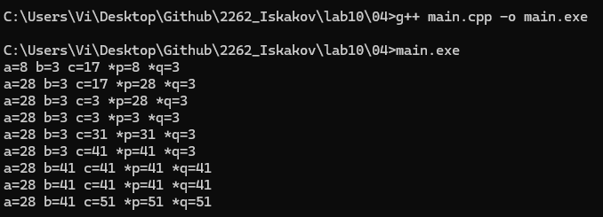

**Объяснение**

Сначала: `a=8, b=3, c=17, p=&a, q=&b`.

- `*p += *q + c;` - к `a` прибавляем `b` и `c`: 8 + 3 + 17 = 28. (`a=28, b=3, c=17, p=&a, q=&b`)
- `c = *q;` - в `c` копируем значение `b` (3). (`a=28, b=3, c=3, p=&a, q=&b`)
- `p = &c;` - `p` теперь указывает на `c`. (`a=28, b=3, c=3, p=&c, q=&b`)
- `c += a;` - к `c` прибавляем `a`: 3 + 28 = 31. (`a=28, b=3, c=31, p=&c, q=&b`)
- `*p += 10;` - `p` указывает на `c`, так что `c` = 31 + 10 = 41. (`a=28, b=3, c=41, p=&c, q=&b`)
- `*q = *p;` - `q` указывает на `b`, записываем туда значение `c` (41). (`a=28, b=41, c=41, p=&c, q=&b`)
- `q = p;` - `q` теперь тоже указывает на `c`. (`a=28, b=41, c=41, p=&c, q=&c`)
- `*q += 10;` - `q` указывает на `c`, так что `c` = 41 + 10 = 51. (`a=28, b=41, c=51, p=&c, q=&c`)

### Задание 5 **(1)**

*Что сравнивается в приведенной ниже программе? Как можно
изменить первую строчку программы, чтобы результат тоже
изменился?*
```
int x = 1, y = 2;
int *p = &y, *q = &x;
if (p < q)
    std::cout << "Yes";
else
    std::cout << "No";
```

**Создадим файл main.cpp**

```cpp
#include <iostream>

int main() {
    int x = 1, y = 2;
    int *p = &y, *q = &x;
    if (p < q)
        std::cout << "Yes" << std::endl;
    else
        std::cout << "No" << std::endl;
    return 0;
}
```

**Компилируем, запустим, проверим результат**

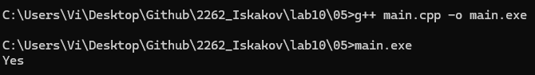

**Создадим файл main2.cpp**

```cpp
#include <iostream>

int main() {
    int y = 2, x = 1;
    int *p = &y, *q = &x;
    if (p < q)
        std::cout << "Yes" << std::endl;
    else
        std::cout << "No" << std::endl;
    return 0;
}
```

**Компилируем, запустим, проверим результат**

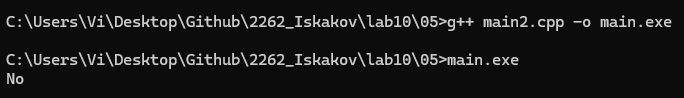

**Объяснение**

В `if (p < q)` сравниваются не сами числа 1 и 2, а адреса переменных `y` и `x` в памяти. Они зависят от того, в каком порядке переменные легли на стеке при объявлении. Поэтому если в первой строчке поменять их местами на `int y = 2, x = 1;`, то и адреса поменяются местами, и вывод станет противоположным.

Согласно Лекции 10 Слайд 312: *"Размещение переменных не регулируется стандартами, поэтому пример может работать по-разному для различных трансляторов."*

### Задание 6 **(2)**

*Объясните работу следующей программы. Как изменится
результат, если тип* **double** *изменить на некоторый другой, например*
**int** *или* **char**?
```
double x = 0;
double *d = &x;
std::cout << reinterpret_cast<size_t>(d + 4) - reinterpret_cast<size_t>(d - 4) << std::endl;
```

**Создадим файл main.cpp**

```cpp
#include <iostream>

int main() {
    double x = 0;
    double *d = &x;
    std::cout << reinterpret_cast<size_t>(d + 4) - reinterpret_cast<size_t>(d - 4) << std::endl;
    return 0;
}
```

**Компилируем, запустим, проверим результат**

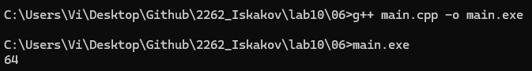

**Объяснение**

Согласно Лекции 10 Слайд 312: *"Допустимо сложение или вычитание типизированного указателя `type*p` и целого числа `n`. При этом адрес в указателе изменяется на `n*sizeof(type)`."*

Указатель `d` указывает на `double`. Когда мы пишем `d + 4` и `d - 4`, адрес сдвигается не на 4 байта, а на 4 элемента типа `double` вперед и назад. Потом `reinterpret_cast<size_t>` превращает оба адреса в обычные числа (в байтах) и мы находим их разницу. Всего между `d - 4` и `d + 4` помещается 8 элементов. Так как `double` занимает 8 байт, программа выводит `8 * 8 = 64`.

Если поменять тип на `int` (4 байта), то выведется `8 * 4 = 32`. Если на `char` (1 байт), то выведется `8 * 1 = 8`.

### Задание 7 **(2)**

*Объясните работу следующей программы. Как изменится
результат, если тип* **double** *изменить на некоторый другой, например*
**int** *или* **char**?
```
std::cout << reinterpret_cast <double*>(3000) - reinterpret_cast <double*>(2000) << std::endl;
```

**Создадим файл main.cpp**

```cpp
#include <iostream>

int main() {
    std::cout << reinterpret_cast<double*>(3000) - reinterpret_cast<double*>(2000) << std::endl;
    return 0;
}
```

**Компилируем, запустим, проверим результат**

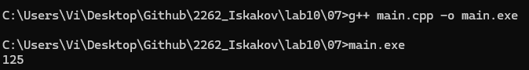

**Объяснение**

Согласно Лекции 10 Слайд 313: *"Допустимо вычитание двух указателей `type*p, *q`. Результатом является целое число равное разности адресов поделенной на `sizeof(type)`."*

Тут числа 3000 и 2000 через `reinterpret_cast` превращаются в указатели на `double` с такими адресами. При вычитании указателей разница 1000 байт делится на размер `double` (8 байт), и выходит `1000 / 8 = 125`.

Если заменить `double` на `int` (4 байта), получится `1000 / 4 = 250`. Если на `char` (1 байт), то `1000 / 1 = 1000`.

### Задание 8 **(2)**

*Что надо дописать в записанной ниже программе вместо многоточий, чтобы
она выводила все числа из массива* **a**? *Почему?*
```
int a[20];
for ( int i = 0; i < 20; i++)
    a[i] = i;
int *b=a + 8;
for (int i =...; i <...; i++)
    std::cout << b[i] <<' ';
```

**Создадим файл main.cpp**

```cpp
#include <iostream>

int main() {
    int a[20];
    for (int i = 0; i < 20; i++)
        a[i] = i;
    int *b = a + 8;
    for (int i = -8; i < 12; i++)
        std::cout << b[i] << ' ';
    std::cout << std::endl;
    return 0;
}
```

**Компилируем, запустим, проверим результат**

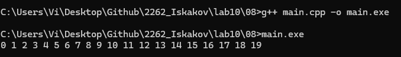

**Объяснение**

Вместо многоточий нужно поставить `-8` и `12`: `for (int i = -8; i < 12; i++)`. 

Указатель `b` указывает на `a[8]`, а обращение `b[i]` работает как `*(b + i)`. Чтобы добраться до самого первого элемента `a[0]`, нужно отступить назад на 8 элементов, поэтому начинаем с `i = -8`. Последний элемент массива это `a[19]`, от `a[8]` до него 11 шагов вперед, поэтому цикл идет пока `i < 12`.

### Задание 9 **(2)**

*Что выводит следующая программа? Изменится ли результат если
изменить тип элементов массива?*

```
int a[10];
std::cout << &a[8] - &a[3] << std::endl;
```

**Создадим файл main.cpp**

```cpp
#include <iostream>

int main() {
    int a[10];
    std::cout << &a[8] - &a[3] << std::endl;
    return 0;
}
```

**Компилируем, запустим, проверим результат**

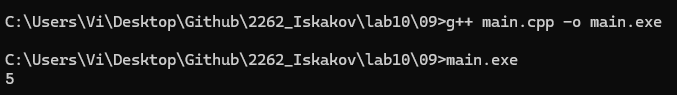

**Объяснение**

Согласно Лекции 10 Слайд 313: *"Разность указателей позволяет определить, сколько элементов указанного типа могут разместиться в диапазоне памяти между указателями."*

Программа выводит `5`. Если поменять тип элементов массива (например на `double` или `char`), результат не изменится, потому что при вычитании указателей считается расстояние между ними в количестве элементов, а не в байтах. Разница адресов в байтах поменяется, но она все равно разделится на размер одного элемента, так что между 8 и 3 индексом всегда будет 5.

### Задание 10 **(1)**

*Есть ли разница между инициализацией* **p** и **q** *в следующей программе? Обоснуйте ответ.*
```
int x [10]={1, 2, 3, 4, 5, 6, 7, 8, 9, 10};
int *p = x + 5;
int *q = &x[5];
```

**Объяснение**

Согласно Лекции 10 Слайд 315: *"Выражение `*(x+i)` тождественно `x[i]` или `i[x]`."* И там же: *"Фактически массив - это указатель на некоторую зарезервированную область памяти."*

Разницы нет, оба указателя получат одинаковый адрес - адрес элемента с индексом 5 (то есть числа 6). `x + 5` просто сдвигает указатель начала массива на 5 элементов вперед, а `&x[5]` берет адрес этого же элемента напрямую (получается `&(*(x + 5))`, то есть ровно `x + 5`).

### Задание 11 **(3)**

*Указатели можно использовать для итерации по массивам.
Напишите программу, которая найдет сумму элементов массива,
используя указатели. В начале цикла указатель требуется установить
на начало массива, в конце каждой итерации смещать его к
следующему элементу массива через инкремент. Для выхода из цикла
надо проверять, что указатель дошел до конца массива.*
```
int x [10]={1, 2, 3, 4, 5, 6, 7, 8, 9, 10};
int s = 0;
for (int *p = ...; ...; ...)
    s += ...
std::cout << s;
```

*Записанную программу сохраните в папке с номером задания.*

**Создадим файл main.cpp**

```cpp
#include <iostream>

int main() {
    int x[10] = {1, 2, 3, 4, 5, 6, 7, 8, 9, 10};
    int s = 0;
    for (int *p = x; p < x + 10; p++)
        s += *p;
    std::cout << s << std::endl;
    return 0;
}
```

**Компилируем, запустим, проверим результат**

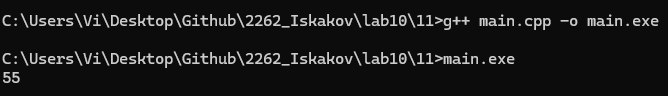

**Объяснение**

В начале цикла ставим указатель `p` на первый элемент массива (`x`). Цикл идет пока `p < x + 10`, где `x + 10` - адрес сразу за последним элементом массива. На каждом шаге двигаем указатель дальше через `p++`, а в `s` прибавляем само значение по адресу с помощью разыменования `*p`. В результате программа выводит 55.

## Дополнительные задания

### Задание 1 **(3)**

*Запишите программу на С++, в которой будет создаваться двумерный массив* **x[10][10]**. *Выведите адреса элементов массива и нарисуйте, как элементы расположены в памяти.*

### Задание 2 **(3)**

*Запишите программу на С++, в которой будет создаваться двумерный массив* **x[10][10]**. *Проверьте, что произойдет при различных выходах за границы массива. Напишите программы для демонстрации и поясните
их работу.* 

### Задание 3 **(6)**
*Напишите пример программы, которая продемонстрирует неопределенное поведение при выходе за границу одномерного массива. Например, чтобы программа зависла, хотя по алгоритму такого не должно произойти.*

### Задание 4 **(8)**
*Изучите самостоятельно работу с динамической памятью. Напишите примеры программ, демонстрирующие особенности работы (например, перемещение при расширении) и возможные ошибки при работе с памятью.*